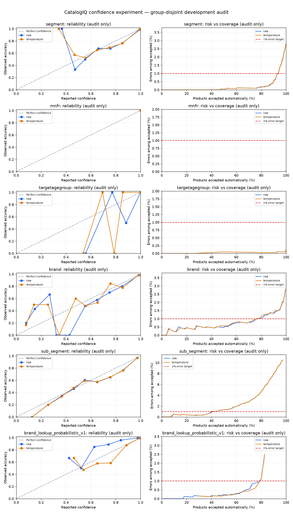

# Confidence calibration and human review: development experiment

**Ticket completion, November 6, 2026:** reuse this experiment and its saved
temperatures; no refitting is needed. The [later uncertainty reassessment](18_accuracy_standard_reassessment_20261103.md)
supersedes the original maximum-family-size qualification calculation below:
Mnfr and age have conditional development support for 99%, while automatic
acceptance remains disabled for every target. The November 6 sections at the end
add practical thresholds, confidence distributions and acceptance status. See
[Max's expanded review contract](../../integration/model_selection_handoff_20261106.md#review-policy-existing-behavior-and-decisions-still-required)
and the [meeting proposal for Ravi](../../integration/review_policy_po_proposal_20261106.md).
The original experiment and historical results below remain intact.

Date: November 3, 2026. Decision: **keep automatic acceptance disabled for all
six models**. Several candidates exceed 99% accuracy in the observed accepted
records, but none passes this experiment's conservative uncertainty requirement.
These findings justify a focused validation pilot, not production release.
Sub-Segment remains provisional; no final model winner was selected.

## What we learned, in ordinary English

Segment was overconfident. Among its audit predictions with confidence above
90%, the average confidence was 99.50%, but only 98.65% were correct. In a batch
of 100 similar predictions, that means roughly 1.35 mistakes rather than the
0.50 mistakes its scores suggested. This is an illustration of the measured
development population, not a forecast for a new retailer.

Calibration adjusts how strongly the model expresses its answer. It does not
teach the classifier anything new or change its chosen classification. Segment's
average confidence moved closer to its observed accuracy, and its probability
scores improved. The Brand lookup improved substantially too: it was initially
too cautious. Calibration did not improve every measure for every model.

The table below shows **experimental candidates**, chosen without looking at
the audit answers. The product counts are what happened per 100 audit records
after the measured information/lookup gates. They are not enabled policies or
estimates from live incoming products. Fractions of a mistake describe an
average over many batches, not a fraction of one product.

| Model | Experimental confidence cutoff | Auto / review per 100 | Wrong among that automatic workload, per 100 incoming | Accepted audit accuracy | Actual accepted errors / accepted rows |
|---|---:|---:|---:|---:|---:|
| Segment MiniLM | 93.0%, calibrated | 92.1 / 7.9 | 0.75 | 99.185% | 31 / 3,803 |
| Mnfr MiniLM | 50.0%, calibrated | 100 / 0 | 0.025 | 99.975% | 1 / 4,076 |
| TargetAgeGroup MiniLM | 50.0%, calibrated | 100 / 0 | 0.125 | 99.875% | 5 / 4,010 |
| Brand MiniLM | 97.0%, original scores | 82.9 / 17.1 | 1.01 | 98.778% | 44 / 3,600 |
| Brand lookup | 95.5%, calibrated, seen keys only | 75.9 / 24.1 | 0.51 | 99.333% | 22 / 3,298 |
| Sub-Segment MiniLM, provisional | 97.7%, calibrated | 46.0 / 54.0 | 0.56 | 98.793% | 22 / 1,822 |

The 50% cutoff does not mean a prediction is only a coin flip: every audit
Mnfr/age prediction happened to clear that floor, and most scores were far
higher. Those two targets need little confidence filtering in this sample.

**Current operational recommendation, for every model: 0 automatically
accepted, 100 reviewed per 100 incoming. No confidence cutoff is approved.**
The experimental cutoffs above are candidates for a new validation exercise.
They should not be copied into production configuration.

## Sources inspected and preserved

Reviewed the repository's prediction/export validators, class mappings,
development preparation, target allocations, frozen group identities, lookup
normalization, Maria harness compatibility code and calibration fixtures.
No classifier checkpoint was loaded or trained.

The input is the six explicitly named owned runs in
`data/processed/predictions_contract_v2_20261031/`, documented in
[the aligned handoff](16_prediction_contract_alignment_20261031.md). The five
MiniLM exports have complete softmax probabilities; the lookup has complete
smoothed training-frequency probabilities. All six have confidence equal to the
maximum class probability, labeled validation context, unique record IDs and
explicit numeric class mappings. Every current OOV truth count is zero.

Reviewed the cached `docs/predictions-contract.md` before implementation, and
then checked [Maria's current document](https://github.com/import-seb/CatalogIQ-Scope/blob/maria/segment-evaluation-harness/docs/predictions-contract.md)
through GitHub. The current document blob is
`0a155cee291f05cdb832c84a438330a343eb8915`; this is a **document blob**, not a
harness commit. The aligned handoff records the earlier reviewed document blob
`662bea5144c3fbf13ecf04f7e42c15eac614df44`. The latest document confirms the
same mapping, context, OOV and protected-ID requirements, describes the harness's
arriving-group comparison fix, and clarifies that generated split completion
seals are directory-local. We verify this directory's seals against its own
files and bind semantic membership to the committed V4 protocol; we do not
require a different machine's generated completion bytes to match this one.

The existing Maria loader/harness and Max's models, code and artifacts were
not modified or run. No search for Max's remaining model was performed.
No `test.csv` was opened or hashed, and no protected labels/features were read.
Protected exclusion uses the existing identity-only registries, including the
committed original membership and grouping fingerprints.

## Experiment design and leakage controls

Original train/validation assignments and target-specific allocations remain
unchanged. Only validation records receive an additional experiment role.
The role is SHA-256 of a fixed salt and frozen `group_id`, reduced modulo three.
All rows in a group receive the same role, and shared groups receive the same
role across targets. The assignment uses neither truth nor confidence.

| Target | Original allocation | Calibration fit rows / groups | Threshold selection rows / groups | Policy audit rows / groups |
|---|---|---:|---:|---:|
| Segment | Frozen V4 | 3,999 / 2,289 | 3,822 / 2,211 | 4,131 / 2,302 |
| Mnfr | Frozen V4, labeled Mnfr subset | 3,948 / 2,269 | 3,788 / 2,209 | 4,076 / 2,266 |
| TargetAgeGroup | Frozen V4, labeled age subset | 3,881 / 2,234 | 3,733 / 2,179 | 4,010 / 2,239 |
| Brand, both models | Approved Brand v1, October 29 | 4,233 / 2,405 | 4,041 / 2,317 | 4,345 / 2,395 |
| Sub-Segment | Approved Sub-Segment v1 r2, October 29 | 3,875 / 2,225 | 3,730 / 2,178 | 3,957 / 2,206 |

The calibration-fit subset supplies one temperature per model. The selection
subset chooses a score variant and cutoff. The audit subset checks that fixed
choice. Audit threshold curves and alternative calibration metrics are saved
as descriptive diagnostics; they are never fed back into selection.

The grid contains 581 thresholds from 50% to 99.9%: 0.1 percentage point
spacing throughout, plus 0.01 point spacing from 99% upward. Thus neighborhoods
around the selected 93%, 95.5%, 97% and 97.7% cutoffs are already evaluated at
0.1 point precision, with finer resolution in the extreme-confidence tail.
All grids and decision criteria were fixed before model evaluation.

Choose the greatest selection coverage whose lower accuracy bound reaches
99%. Break coverage ties by lower selection NLL, then lower cutoff and variant
name. If none passes, select an **exploratory-only** candidate using observed
99% selection accuracy and maximum coverage; if even that fails, retain the
lowest-error nonempty candidate for diagnosis. An exploratory candidate cannot
be promoted by looking at a favorable audit. There is no audit-driven fallback.

### Uncertainty: correlated rows and an intentionally strict safety check

The audit population has roughly 2,200 independent groups per target, not
4,000 independent products. Some accepted groups have 59–81 rows. If a
classification pattern is wrong, many related rows may be wrong together.

For transparency, two different uncertainty summaries are retained:

1. A descriptive 95% interval from 2,000 resamples of whole product groups.
   This reflects the observed mixture of groups. It can miss unseen failure
   patterns; zero-error bootstrap samples can misleadingly yield [100%, 100%].
2. A conservative one-sided bounded-cluster concentration bound. It allows
   arbitrary dependence within each group. Only this second bound can qualify
   a policy. Searching many cutoffs is accounted for before selection.

| Fixed candidate | Descriptive group-bootstrap accuracy interval | Conservative lower accuracy bound |
|---|---:|---:|
| Segment | 98.852%–99.481% | 87.267% |
| Mnfr | 99.923%–100.000% | 90.561% |
| TargetAgeGroup | 99.748%–99.975% | 90.028% |
| Brand MiniLM | 98.363%–99.166% | 84.959% |
| Brand lookup | 98.942%–99.632% | 85.545% |
| Sub-Segment, provisional | 98.180%–99.300% | 79.944% |

The last column is a deliberately pessimistic safety bound, **not an estimate
that Mnfr is only 90.6% accurate**. It is loose because it allows a whole large
group to fail together, with few assumptions about how errors vary by group.
Mnfr and age look strong under the usual bootstrap assumptions. No candidate
passes the stricter criterion, so the experiment does not authorize automatic
acceptance. A less conservative analysis would need explicit assumptions and
new evidence, not a change made simply to obtain a passing result.

Technical definition: let G be the number of accepted groups, M the largest
accepted group size, N the accepted row count, and E the accepted errors. Each
group contributes X_g=errors_g/M in [0,1]. For independent groups and fixed
accepted volumes, invert `G * KL(E/(G*M) || u) = log(1/alpha)` for the upper
mean error contribution u; the lower row-accuracy bound is
`max(0, 1 - G*M*u/N)`. With zero errors, `u=1-alpha**(1/G)`, so the bound
still leaves room for mistakes. This bounded-variable Chernoff calculation
does not assume independence among rows in the same group. It does assume
independence across groups and conditions on the observed group volumes.
It does not cover future changes in those volumes or in the product mixture.

Selection uses `alpha=.05/(6*2*581)` simultaneously over six models, two score
variants and all cutoffs. The fixed audit candidate for each model uses
`alpha=.05/6`, giving a family-wide one-sided 95% error allowance under the
stated assumptions. Other displayed audit cutoffs are descriptive, not jointly
certified. Exact binomial row-only bounds are saved as a clearly labeled
reference and are not used, because duplicated rows violate their independence
assumption. No finite sample provides an unconditional future guarantee.

### Existing-validation limitations

The original validation populations already influenced checkpoint/model
selection and earlier investigations. These new roles prevent additional
fit/selection/audit contamination inside this experiment; they cannot undo
that historical reuse. Development audit means held apart for this procedure,
not never previously seen. A genuinely new, representative development
collection is needed to qualify a final fixed policy. The protected test
must remain closed for this work.

The data is cleaned, labeled development data. It is not a sample of all future
incoming products, including missing information, new brands or new retailers.
Coverage here will usually overstate coverage on less complete inputs.
The two Brand models share their allocation; comparing Brand to other targets
does not imply their validation populations are identical. Product counts
across targets must not be added as if they were independent products.

## Calibration before and after

Temperature scaling raises probabilities to `1/T` and renormalizes them. With
positive exported softmax probabilities this equals scaling logits up to a
shared constant. Original logits were not supplied. Exact zero probabilities
remain zero, class order and ties are retained, and no winning class changes.
The scalar is fitted on calibration-fit NLL over T in [0.05, 20].
No fitted temperature hit the bounds.

ECE is the weighted gap between confidence and correctness in ten right-closed
confidence bins; lower is better. Brier score measures the squared error of
the entire probability vector; lower is better. NLL penalizes assigning too
little probability to the true answer, especially confident mistakes; lower
is better. ECE depends on binning, and no single score proves calibration.

All figures below come from the same audit rows, before information/lookup
gating. Raw and calibrated classification accuracy are exactly equal.

| Model | Fitted T | Accuracy | Mean confidence, before → after | ECE, percentage points, before → after | Brier, before → after | NLL, before → after |
|---|---:|---:|---:|---:|---:|---:|
| Segment | 1.176651 | 97.168% | 98.271% → 97.489% | 1.1905 → 0.4274 | .046144 → .045186 | .094107 → .091663 |
| Mnfr | 1.185426 | 99.975% | 99.995% → 99.984% | .0199 → .0088 | .000490 → .000489 | .001510 → .001392 |
| TargetAgeGroup | 1.414984 | 99.875% | 99.953% → 99.720% | .0888 → .2209 | .002060 → .002035 | .006800 → .007313 |
| Brand MiniLM | 1.038600 | 96.916% | 97.417% → 96.937% | .6737 → .5954 | .051927 → .051891 | .140514 → .142006 |
| Brand lookup | .753034 | 95.742% | 88.633% → 96.274% | 7.1492 → .5603 | .084365 → .071492 | .242306 → .182271 |
| Sub-Segment | .997084 | 88.249% | 90.526% → 90.588% | 2.6452 → 2.6831 | .177820 → .177897 | .384041 → .384053 |

Segment and Mnfr improve across these scores. Lookup improves substantially
and flips from overall underconfidence to slight overconfidence. Age has a
worse ECE and NLL despite a marginally better Brier score. Brand's ECE/Brier
improve slightly but its NLL worsens; its selected policy uses raw scores.
Sub-Segment barely changes and all three scores worsen slightly. These are
observed comparisons, not significance claims. Do not choose a replacement
variant after inspecting the audit; test a revised policy on new data instead.

OOV truth remains an error in all calculations. Brier extends truth with an
extra zero-probability class, rather than using an all-zero target vector.
True-probability zero makes mathematical NLL infinite; JSON reports this with
an explicit flag and null, plus a separately labeled 1e-15-clipped sensitivity
score. The temperature fit declines an unidentified infinite-NLL case instead
of silently dropping its rows. Current real exports have no such cases.



Sparse reliability bins can contain only two or three records, so a connected
line is a diagnostic aid, not evidence of precision. Risk curves show observed
errors among accepted records; the red line is 1% error. No point on these
curves, by itself, certifies the desired future accuracy.

## Class coverage and lookup-specific risks

Full per-class tables retain the saved model vocabulary plus OOV truth,
including classes with zero support. They report truth-class coverage, false
automatic emissions, missed true-class errors and accepted precision. A blank
accuracy/coverage means there was no denominator; it never means 100%.

Aggregate success can hide weaker classes. Examples from the fixed policies:

- Segment's accepted Allergy predictions are only 96.0% correct (6 errors in
  150), while Vitamins/Minerals/Supplements is 99.75% (6 in 2,406). True-class
  coverage ranges from 82.40% for Internal Analgesics to 94.99% for Vitamins.
- Mnfr's aggregate accepted accuracy is 99.975%, but its J&J accepted precision
  is 73/74, or 98.65%. A global 99% target does not promise 99% for each class.
- Age has only 41 Infant audit truth rows. Its apparent strength is not a
  reliable class-specific guarantee; one Infant truth row is accepted as
  another class.
- Brand has 23 vocabulary classes with no audit truth support; 137 of 143
  classes have fewer than 50 audit rows, including the absent classes. Brand
  MiniLM accepts none of the audit truth rows for 61 represented classes.
  Its accepted Other Brands precision is 87.5% (10 errors in 80).
- Lookup accepts no truth rows for 12 represented Brand classes. Rare errors
  remain: Codeage precision is 5/6 and Irwin Naturals is 8/9, despite the good
  aggregate policy score.
- Sub-Segment has four absent audit classes and 31 classes below 50 rows;
  23 represented true classes receive no automatic coverage at this cutoff.

The lookup probabilities come from smoothed training key/class counts, not
neural softmax scores. In its audit there are 3,597 seen keys and 748 unseen
keys. The two missing ProductBrand validation records fall outside this audit
subset but are covered by the missing-key gate and synthetic tests.
For unseen keys, raw confidence is 62.60% versus 87.43% correctness; temperature
scaling raises it to 88.82%. This is still just the same fallback prior for
each unseen key. **A larger calibrated fallback score is not new evidence about
that brand.** Missing and unseen keys are always reviewed. No lookup was refitted.

## Mandatory review: implemented versus pending

Implemented and tested in the reusable decision function:

- Disabled/unapproved policy, missing cutoff, or provisional model.
- Confidence strictly below the selected cutoff; equality clears this check.
- Name, description and contents all missing, using the existing trimmed
  blank/null definition in `structural.py` and [the decision log](../../decisions.md).
  Native JSON null and DataFrame missing values are also treated as absent.
  An absent name alone does not force review if description or contents exists.
- Existing structural quarantine when supplied by the integration layer.
- Nonfinite, negative, unnormalized or wrong-size probabilities; unsupported
  predicted class; class disagreement with the probability argmax.
- Missing/unseen lookup key, even after calibration raises its score.
- Conflicting or incomplete classifications under an explicitly supplied
  approved relationship map. Multi-parent allowed pairs are supported.
  Unapproved relationship rules are rejected.

Measured development coverage applies the essential-text and lookup-key gates.
The development source has already passed the existing screening workflow; no
additional essential-text failures occur in these scored populations. There is
no approved hierarchy map to apply to the real rows, and we do not claim that
hierarchy gating was measured.

Pending owner decisions/integration, with no invented defaults:

- A versioned, evidence-backed relationship registry, including any Brand/Mnfr
  constraints. The older relationship research document is hypothesis evidence,
  not an approved complete mapping. The current decision log explicitly forbids
  a fixed single-parent Segment/Sub-Segment whitelist.
- Wiring current quarantine flags and complete product information into serving.
- Defining detectable retailer/domain drift, newly unsupported taxonomy values,
  low-margin ambiguity and rare-class handling. These are not implemented as
  calibrated operational rules, and confidence cannot identify every unusual
  input or in-vocabulary semantic mistake.
- A product-level policy for combining multiple target decisions and model
  disagreements. Per-target acceptance figures are not full-record acceptance.

Every exported policy has `enabled=false` and `operational_threshold=null`.
The runtime primitive also defaults to disabled. No deployment was performed.

## Reproduction, outputs and tests

Reusable code:
[calculations and review decisions](../../../src/catalogiq/confidence_calibration.py),
[experiment runner](../../../src/catalogiq/confidence_experiment.py), and
[standalone plotting](../../../src/catalogiq/confidence_plots.py).
The CLI adapter is in `catalogiq.cli`; the thin script is
`scripts/evaluate_confidence_review.py`. The optional `calibration` dependency
adds Matplotlib; it does not change the classifier environment requirements.

From the repository root, with the existing environment and the isolated
plotting cache used for this run:

```powershell
$env:PYTHONPATH = 'src'
.venv-gpu/Scripts/python.exe scripts/evaluate_confidence_review.py `
  --plot-cache .cache/calibration_plot_deps `
  --output-root data/processed/confidence_review_repetition_20261103
```

For a new environment, install the project with the `calibration` extra and
omit `--plot-cache`. Scientific package versions in this run: Python 3.13,
NumPy 2.3.3, pandas 2.3.2, SciPy 1.16.2, scikit-learn 1.7.2,
Matplotlib 3.11.2. Exact Python version and code/input hashes are in summary.json.
Pin these versions when reproducing numerical and plotting artifacts.

Final package: `data/processed/confidence_review_v3_20261103/`. It contains:

- `protocol.json`, `results.csv`, `calibration_comparison.csv`, `summary.json`
  and `completion.json` with output checksums.
- Per model: fitted temperature, policy, role/group assignments, subset counts,
  measured-gate reasons, raw/calibrated metrics and reliability bins.
- Per model: all threshold results and all per-class results at every threshold,
  selected-policy per-class results, lookup/neural cohort diagnostics, and SVG/PNG
  calibration/risk charts. No raw product text is exported.

The runner refuses existing output directories, validates the independent
approved contexts and registry, and rechecks all 53 consumed input files after
evaluation. None changed. The large local output package is about 75 MB and
remains gitignored. Compact aggregate tables, selected-class tables, charts and
verification evidence are retained beside this report in
`confidence_review_20261103/`. They contain no product text or record IDs.
`confidence_review_v1_20261103/` and `confidence_review_v2_20261103/` are earlier
numerically identical completed runs. v2 fixes Windows workspace permission
inheritance when publishing artifacts; v3 also hardens review handling for
native missing values, malformed cutoffs and incomplete relationship settings.
A preceding plotting failure published no partial package. None of these
compatibility fixes changes the grid, allocations or selection criterion.

To add Max's future candidate, supply its contract-compliant validation export
and the SHA-256 of its manifest explicitly:

```powershell
.venv-gpu/Scripts/python.exe scripts/evaluate_confidence_review.py `
  --candidate-run path/to/explicit_candidate `
  --candidate-manifest-sha256 ACTUAL_MANIFEST_SHA256 `
  --output-root data/processed/confidence_with_explicit_candidate `
  --plot-cache .cache/calibration_plot_deps
```

It must use an approved target context/allocation and pass the same guards.
No remaining candidate is discovered automatically. Adding a model updates the
family-size correction, so it is a new experiment, not an invisible append.

**71 relevant tests passed**: 23 new confidence/calculation/leakage/review tests,
21 existing prediction-contract tests, 17 MiniLM export tests and 10 lookup tests.
The new tests use synthetic data; the existing tiny saved-state inference test
does not optimize weights or access project classifier checkpoints.

```powershell
$env:PYTHONPATH = 'src;tests'
.venv-gpu/Scripts/python.exe -m unittest test_confidence_calibration `
  test_prediction_contract test_minilm_prediction_export `
  test_brand_probabilistic_lookup -q
git diff --check
```

Coverage includes unchanged temperature/selection after audit-label changes,
group-disjoint role assignment, approved context and seal checks, protected
record/group exclusion, arriving-group disagreement, exact calculations,
OOV/zero probability, empty acceptance, endpoint/tie behavior, sparse classes,
zero-error bootstrap limitations and mandatory review rules. The final local
artifact verification rechecks every output seal and source/code hash and
compares the repeated aggregate results. The full training suite was not run;
no classifier training or protected-test scoring is needed for these changes.

## What this means for CatalogIQ

Confidence can help reduce review work, but a high number is not a promise.
This experiment identifies where the opportunity is largest and where mistakes
remain hidden. Start a reviewer-confirmed development pilot with Mnfr and
TargetAgeGroup, then Segment and the seen-key Brand lookup. Keep Brand MiniLM
and Sub-Segment as reviewer suggestions while their policies need more evidence.

Freeze these candidate choices before collecting new representative development
labels. Include enough independent product groups and uncommon classes, approve
the relationship rules, and measure the complete review policy on that new data.
Until then, people retain approval authority. The practical value is a reusable
way to decide how much work can safely be automated, with an honest record of
the remaining mistakes, rather than treating a model's confidence as certainty.

## November 6 completion: reuse, verification and remaining gaps

Reviewed latest main `cebfe9d5df392a6b49487909e4bd9179634adcb4` (PR #31), the
unchanged [model-selection decisions](20_model_selection_20261106.md), Maria's
branch `a41608e83dd3f1420ce5cb63a28b022254f879d4`, and Max's PR #23/head
`618010afaf5a6d9a4ee7b9a23fef7c8c996bb22c`. Maria's current notebook blob is
`5670c9d55777f8f9b313b3f1e7835145fd5a6885`; her contract blob remains
`0a155cee291f05cdb832c84a438330a343eb8915`.

Also reviewed Maria's [Segment evaluation report](https://github.com/import-seb/CatalogIQ-Scope/blob/a41608e83dd3f1420ce5cb63a28b022254f879d4/docs/segment-evaluation.md),
blob `573935a2b16051bd5f3be8c5ee918e8feb550766`. It already measures Max's
classical Segment calibration/review queue: TF-IDF+category ECE 2.65% to 0.44%
at T=.80, versus MiniLM 1.37% to .53% at T=1.20. Those are full-11,952-row,
same-population fit/score diagnostics, not our group-held-apart audit and not
qualified temperatures for other targets. Her MiniLM .95 queue has 9.06% load
and 21.37% error miss rate; our audit .95 numbers below use another population
and saved T, so the percentages must not be treated as a reproduction failure.
Her matched-load comparison finds margin essentially tied with confidence for
MiniLM, and her relationship rule remains unwired. We reuse those findings
instead of assuming that margin is better or inventing a relationship map.

Existing responsibilities are retained: Maria supplies ECE/Brier, fixed-coverage
and queue definitions; `confidence_calibration`/`confidence_experiment` supply
group-disjoint calibration, threshold curves, OOV-safe metrics and review
primitives; `clustered_accuracy` supplies the later working-model bounds; the
product-rule study supplies the already frozen class/description alternatives.
No replacement framework, inference adapter or new modeling experiment was built.
Missing deliverables were the accessible practical-threshold comparison, confidence
distributions, application severity/precedence/correction contract and PO proposal.

The read-only completion check verified sealed confidence and reassessment
packages and independently approved target contexts, reconstructed existing
group roles and measured eligibility gates, and reapplied the saved temperatures.
It reproduced **36 calibration comparisons and 40 practical-threshold rows**
(raw and scaled, five selected/provisional targets). It executed only Maria's
reviewed `ece_and_reliability`, `multiclass_brier`, `queue_metrics`, `coverage_risk`,
`class_set` and `macro_f1_on` function definitions, with agreement on applicable
metrics. Notebook setup, model fitting, temperature fitting and discovery cells
were not executed. The current exports have no OOV truth; Maria's older OOV
Brier/temperature behavior is therefore not evidence of valid OOV calibration.

All **141 consumed evidence files** were rehashed unchanged; no classifier was
loaded, no calibration fitted, and no policy, original prediction or split changed.
Max's supplied classical **Sub-Segment** models remain comparison candidates,
not the selected route; no Sub-Segment classical calibration results were found.
That is missing evidence, not poor calibration, and does not erase Maria's
classical Segment measurements above. Platform remains deferred. The source packages and historical
verification fields are preserved; the two existing compact CSVs were extended
for reporting rather than creating duplicate analyses.

## Practical cutoffs: observed workload, escaping errors and uncertainty

All figures below use the existing **temperature-scaled** variant for the five
selected/provisional models, without choosing a new variant or cutoff from the
audit. The Brand row is the probabilistic lookup, not Brand MiniLM. Acceptance
means confidence **at least** the cutoff and passing the already measured
essential-text/seen-key gates. It is hypothetical eligibility, not authorization.
Unapproved policies, new class-risk rules and future hierarchy rules are not
included in these historical workloads. Actual operation still reviews 100%.

The denominator is each target's policy-audit population, not its entire original
validation population. The 95% intervals below are descriptive two-sided
percentile intervals from 2,000 whole-group resamples, seed 20261106. They are
not simultaneous, not new threshold-selection evidence and not prospective
guarantees. Zero observed errors can produce misleadingly perfect bootstraps.

| Target; audit rows | Cutoff | Review % | Unflagged accuracy % | Escaping errors / unflagged rows | Descriptive 95% accuracy interval % |
|---|---:|---:|---:|---:|---|
| Segment; 4,131 | .80 | 3.87 | 98.439 | 62 / 3,971 | 97.961–98.859 |
| Segment | .90 | 6.32 | 99.018 | 38 / 3,870 | 98.615–99.352 |
| Segment | .95 | 9.32 | 99.439 | 21 / 3,746 | 99.138–99.676 |
| Segment | .99 | 30.14 | 99.896 | 3 / 2,886 | 99.759–100.000 |
| Mnfr; 4,076 | .80 | 0.00 | 99.975 | 1 / 4,076 | 99.924–100.000 |
| Mnfr | .90 | 0.00 | 99.975 | 1 / 4,076 | 99.924–100.000 |
| Mnfr | .95 | 0.05 | 99.975 | 1 / 4,074 | 99.924–100.000 |
| Mnfr | .99 | 0.05 | 99.975 | 1 / 4,074 | 99.924–100.000 |
| TargetAgeGroup; 4,010 | .80 | 0.07 | 99.925 | 3 / 4,007 | 99.828–100.000 |
| TargetAgeGroup | .90 | 0.17 | 99.925 | 3 / 4,003 | 99.828–100.000 |
| TargetAgeGroup | .95 | 0.30 | 99.925 | 3 / 3,998 | 99.827–100.000 |
| TargetAgeGroup | .99 | 1.10 | 99.950 | 2 / 3,966 | 99.872–100.000 |
| Brand lookup; 4,345 | .80 | 19.98 | 98.878 | 39 / 3,477 | 98.403–99.271 |
| Brand lookup | .90 | 21.75 | 99.059 | 32 / 3,400 | 98.612–99.419 |
| Brand lookup | .95 | 24.03 | 99.334 | 22 / 3,301 | 98.941–99.649 |
| Brand lookup | .99 | 38.85 | 99.699 | 8 / 2,657 | 99.480–99.886 |
| Sub-Segment; 3,957 | .80 | 16.10 | 94.066 | 197 / 3,320 | 93.128–94.950 |
| Sub-Segment | .90 | 26.91 | 96.715 | 95 / 2,892 | 95.943–97.416 |
| Sub-Segment | .95 | 38.51 | 97.945 | 50 / 2,433 | 97.310–98.515 |
| Sub-Segment | .99 | 79.15 | 99.636 | 3 / 825 | 99.162–100.000 |

The [existing shortlist CSV](confidence_review_20261103/threshold_shortlist.csv)
now includes .80 alongside all former cutoffs, raw/scaled and selection/audit
rows. For the 20 displayed rows it also records the revised conditional beta
lower bound, minority support/errors, wrong per 100 incoming, flag precision
and miss rate. Blank diagnostic fields on other rows mean not recomputed here.
Maria's zero-denominator queue displays are represented as null rather than
claiming measured precision when no products were flagged.

The revised conditional beta lower bounds at .99 are only **98.626% for Brand
lookup and 97.725% for Sub-Segment**, despite the bootstrap intervals above.
Sparse escaping errors and unequal family sizes make the method assumptions
matter. Use the predeclared primary method and its limitations rather than
choosing whichever interval happens to clear 99%.

Higher cutoffs can sacrifice many correct suggestions: Mnfr's .99 cutoff reviews
two correct audit predictions and still misses its one error. On Segment, .95
flags 385 rows, 24.94% of which are errors, but 17.95% of all errors escape;
.99 flags 1,245 rows, only 9.16% errors, and 2.56% of all errors escape. Higher
review volume therefore does not automatically mean more efficient review.

## Confidence distributions and minority-class tradeoffs

The [extended calibration table](confidence_review_20261103/calibration_comparison.csv)
retains all ECE/Brier/NLL results and adds correct/incorrect counts and 10th,
50th and 90th confidence percentiles by model, variant and role. Audit medians:

| Selected/provisional model | Correct / incorrect rows | Median confidence when correct, raw to scaled % | Median confidence when wrong, raw to scaled % |
|---|---:|---:|---:|
| Segment | 4,014 / 117 | 99.889 to 99.604 | 87.499 to 82.597 |
| Mnfr | 4,075 / 1 | 99.998 to 99.990 | 99.743 to 99.350 |
| TargetAgeGroup | 4,005 / 5 | 99.990 to 99.820 | 99.354 to 97.085 |
| Brand lookup | 4,160 / 185 | 97.329 to 99.667 | 62.604 to 88.820 |
| Sub-Segment | 3,492 / 465 | 97.760 to 97.800 | 76.125 to 76.304 |

There is substantial overlap: high-confidence errors survive. Mnfr's single
wrong score is a case description, not a stable error distribution. Lookup's
wrong-score median rises after calibration because many fallback records share
one prior; missing/unseen keys must still be reviewed. Average calibration
quality cannot establish per-class correctness. Existing reliability and
risk-coverage charts above remain the scientific figures for this task.

For the additional shortlist diagnostics, "minority" means a represented truth
class with fewer than 50 rows **in that target's audit**, an analysis definition
only. Truth is unavailable at prediction time; do not implement it as a runtime
gate. At .95, Sub-Segment leaves 164/490 minority truth rows unflagged with
13 errors (92.07% accuracy), versus 37 errors among 2,269 common-class rows
(98.37%). At .99, **zero of those 490 minority rows pass**. High aggregate
accuracy has been bought by giving them no unreviewed coverage.

Age's .99 cutoff passes only 25/41 Infant audit truth rows and still makes one
error among them (96%); its common-class accepted accuracy is 99.975%.
Lookup's .99 cutoff passes 1,117/1,235 minority truth rows with zero errors, but
several individual represented brands receive no coverage; this is not a
guarantee for every rare brand. Segment/Mnfr have no audit classes below that
50-row definition, yet Other Self Care and J&J are still minority classes
relative to the majority and must remain visible in per-class reporting.

Maria's fixed-coverage tool was also exercised, without introducing operational
cutoffs: keeping the most confident half of Segment retains only two observed
classes; keeping 90% of Mnfr retains only one. Its macro-F1 output is deliberately
unavailable when the full-coverage class mix disappears. These rankings can split
equal-confidence ties and omit lookup gates; they are diagnostics, not a
replacement for the cutoff-plus-gate table above.

## Interpreting the 99% objective and closing the ticket

- **Per-target overall validation accuracy:** Mnfr 99.966% and age 99.751%
  already exceed 99%; Segment 96.946%, lookup 95.689% and Sub-Segment 88.583%
  do not. These use full original labeled validation populations, unlike the
  smaller audit rows in the threshold table.
- **Unflagged accuracy:** some audit cutoff rows exceed 99%, including
  Sub-Segment .99 at only 20.85% coverage. This is a conditional subset score,
  not overall accuracy or permission to deploy the cutoff.
- **Statistical support:** the existing independently selected Mnfr/age recipes
  pass the later working-model lower bounds. Segment/lookup/Sub-Segment recipes
  do not. The newly displayed Segment .99 beta diagnostic also exceeds 99%, but
  promoting that result after inspecting this audit would be new selection on
  reused data. No new winner/threshold is selected here. Group-size/risk
  dependence, minority coverage and historical reuse still limit every claim.
- **All-target product correctness:** unmeasured. Different target allocations
  cannot be averaged or their accuracies multiplied to claim a fully correct
  product rate. Platform has no selected model.
- **Accuracy after human correction:** unmeasured. Reviewing every product is
  an operating safeguard, not evidence that people correct every mistake.
  A separately audited corrected-export sample is required.

Propose **at least 99% correctness per target among predictions used without
human review**, with frozen policy, group-aware one-sided uncertainty,
review coverage, escaping errors, minority coverage and critical-error counts
reported together. This is a qualification objective, not a current claim.
Also measure whole-product correctness and audited corrected-export accuracy
as distinct business outcomes. The PO proposal defines the recommended launch
policy, alternatives, assumptions and five prioritized decisions.

| Acceptance criterion | Completion status | Evidence / follow-up |
|---|---|---|
| Evaluate thresholds and calibration | Satisfied for all five available selected/provisional targets | Existing held-apart calibration and charts; verified practical cutoff table, confidence distributions and minority diagnostics. Platform explicitly deferred. |
| Assess 99% goal and uncertainty | Satisfied as a development assessment | Original and revised group-aware analyses reconciled; numerical pass distinguished from prospective approval, whole-product and corrected-export accuracy. |
| Document mandatory human-review conditions | Satisfied as a proposal | Severity, reason codes, approved-map limits and no-threshold defaults in Max's handoff; no fabricated hierarchy. |
| Provide review rules for application integration | Satisfied as a specification | Versioned envelope, OR/precedence rules, CSV lifecycle, unavailable outputs and human corrections documented; dashboard wiring remains Max's work. |
| PO decision proposal | Satisfied | Meeting-ready recommendation, three quantified alternatives and five finding/proposal/tradeoff questions. |
| Enable production policy / certify 99% | Pending follow-up, not an acceptance criterion for this assessment ticket | Ravi/team approval, fresh representative validation and operational measurement; no production cutoff enabled. |

The assessment/specification ticket can close on review of these deliverables.
Policy approval, fresh-data qualification and dashboard implementation remain
explicit follow-ups; no external ticket status was changed.

## Reproduction files and maintained entry point

The one-off cache projection has been integrated into the existing workflow.
Only the reporting orchestration and the required reviewed reference functions
were promoted. There is no second evaluator and no notebook-cache dependency.

| Required repository code | Responsibility |
|---|---|
| `scripts/evaluate_confidence_review.py` and `src/catalogiq/cli.py` | Existing entry point; `--summarize-saved` selects replay instead of fitting calibration. |
| `src/catalogiq/confidence_experiment.py` | `summarize_saved` validates sources, reapplies saved temperatures and projects the compact findings into a fresh directory. |
| Existing `confidence_calibration.py`, `clustered_accuracy.py`, `prediction_contract.py` and imported preparation/identity helpers | Reuse the original calculations, group bootstrap, bounds, feature gates and protected-ID checks. No algorithms were copied into a new implementation. |
| `src/catalogiq/maria_harness_compatibility.py` and packaged `resources/maria_review_a41608e.py` | Fingerprinted Maria metric/queue/coverage definitions, without notebook setup, training/discovery cells or notebook outputs. |

The reference resource also replaces the old calibration-only test fixture:
its three existing definitions are byte-identical at the function level. The
historical temperature-fitting reference is retained for existing compatibility
tests but never called during saved replay. Existing tests now use that shared
resource instead of maintaining a duplicate. Package metadata includes the
resource, so the replay works from an installed wheel as well as a checkout.

The following **private inputs stay in their current locations**; do not move
them into source control or download/deserialize model binaries for this replay:

- `data/processed/predictions_contract_v2_20261031/`: root completion and each
  of the six explicitly named runs' manifest, predictions, context, mapping and
  ID-only registry; lookup `model.json` supplies existing key metadata for gates.
  Brand MiniLM remains present only to reproduce the original comparison rows.
- `data/processed/confidence_review_v3_20261103/`: root completion and calibration
  table; per run, `temperature.json`, `policy.json`, `experiment_assignments.csv`,
  `calibration_metrics.csv` and `thresholds.csv`.
- `data/processed/split_integration_reproduced_20261010/`: existing completion,
  protocol, assignments, train/validation development data and protected identity
  metadata. The approved Brand v1/Sub-Segment v1 r2 allocations and original
  `split_finalization_20261009/frozen/protected_final_test.csv` identity registry
  remain necessary for the existing independent population checks.

The replay's `verification.json` records the exact consumed file list and raw
hashes. It needs neither checkpoints/`.joblib` files, the full Maria notebook,
plotting caches, original charts nor the simulation trial archive. Protected
features/labels and `test.csv` remain inaccessible. Matplotlib is unnecessary for
saved replay; it is required only to regenerate the original scientific charts.

With the existing environment and private inputs, run from the repository root:

```powershell
$env:PYTHONPATH = 'src'
.venv-gpu/Scripts/python.exe scripts/evaluate_confidence_review.py --summarize-saved data/processed/confidence_review_v3_20261103 --output-root data/processed/confidence_summary_reproduction_20261106 --bootstrap-samples 2000 --summary-seed 20261106
```

Choose a new output directory for each repetition. The command refuses existing
outputs and overlap with source directories, preserves sealed sources and writes
`threshold_shortlist.csv`, `calibration_comparison.csv`, `fixed_coverage.csv`,
`verification.json` and `completion.json`. The two compact tables reproduce the
published documentation tables **byte for byte**: 264 shortlist rows, 36
calibration rows, 40 verified raw/scaled practical cutoff comparisons and 20
selected-variant group-aware diagnostics. Fixed-coverage output retains Maria's
class-mix warnings as unavailable macro-F1 values.

The original experiment commands earlier in this report still reproduce the
full calibration experiment in a fresh directory when needed. Saved replay does
not refit anything. Historical cache-script fingerprints remain provenance under
`completion_20261106` in [verification.json](confidence_review_20261103/verification.json);
the maintained replay and its new provenance are recorded separately. No
temporary notebook, cache log or duplicate executable is required.

Verification of the maintained path: **673 tests passed**, including saved-replay
integrity/refusal checks, existing calibration/lookup compatibility and the full
repository suite. A wheel build and isolated wheel import confirmed the reference
resource is packaged. Real replay reverified **83 necessary input files** and
reproduced both published compact tables byte for byte. The prior 141-file check
also sealed ancillary historical results; those extra charts/simulation outputs
are not needed for this replay. Detailed new provenance is under
`maintained_reproduction_20261106` in the existing verification record.
