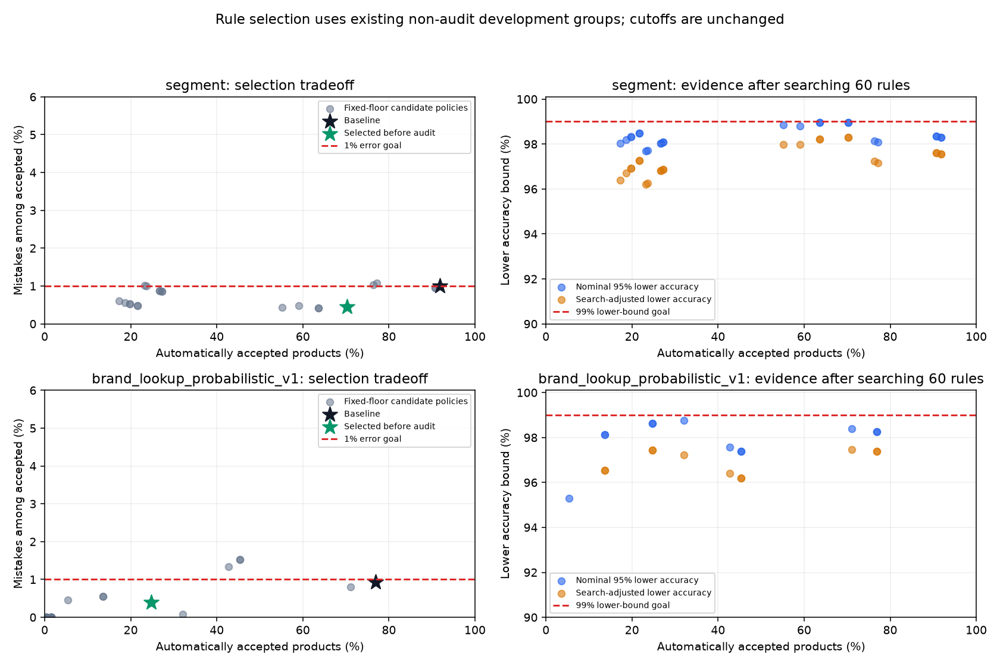
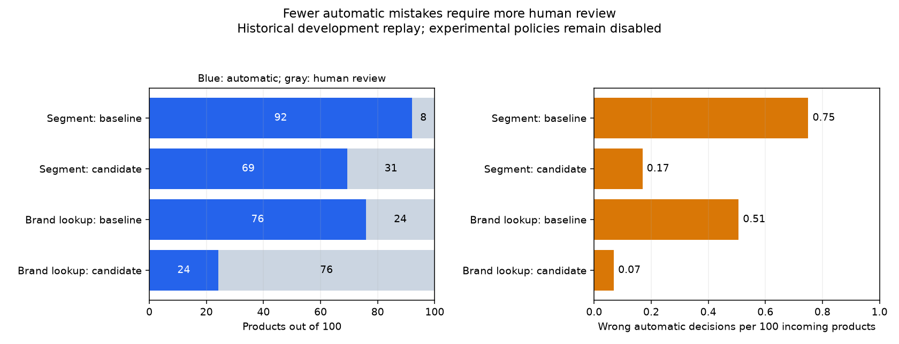

# Product-specific review rules: Segment and Brand lookup

November 3, 2026. **Exploratory findings, not independently confirmed policies.**
The 99% accepted-accuracy goal, existing confidence cutoffs, models, predictions,
class mappings, frozen groups and approved allocations remain unchanged.
Automatic acceptance remains disabled.

## What we learned

There is a practical way to reduce automatic mistakes by routing more products
to people. A discovery-selected Segment rule accepts only three predicted
classes: **External Analgesics, Lifestyle CHC, and Vitamins, Minerals &
Supplements**, still requiring the original calibrated confidence of at least
93% and the existing mandatory review checks.

On the historical audit replay this reduces automatic mistakes from 31 to 7,
while reducing automatic coverage from 92.1% to 69.3%. Observed accepted
accuracy rises from 99.185% to 99.756%. That is promising, but the rule did not
clear the search-adjusted selection check. Its ordinary audit lower bound is
99.024%; its two-policy-adjusted lower bound is only 98.864%. This is not a
statistically established 99% approval policy.

For Brand lookup, the selected experimental rule adds a nonmissing description
to the existing seen-key, essential-information and calibrated 95.5% confidence
requirements. Historical automatic mistakes fall from 22 to 3, but coverage
falls from 75.9% to 24.1%. Its preferred lower bound remains below 99%.
Description presence is an observational association, not proof that a
description improves this lookup; the lookup itself still uses ProductBrand.

**Recommendation:** use the Segment rule as a candidate for a reviewer-confirmed
pilot. Treat the Brand description gate as a secondary experiment with a large
review-workload cost. Neither should authorize unattended approval. There is
no newly established reliable-99% product group in this analysis.

## Historical audit comparison

These are counts from existing labeled development records, not live incoming
products. The per-100 figures apply only if incoming products resemble this
population. Rates are per target and must not be added to infer fully automatic
classification across all targets.

| Model and policy | Accepted / reviewed | Automatic / review per 100 | Wrong automatic classifications | Accepted accuracy | Preferred 95% lower bound | Two-policy-adjusted lower bound |
|---|---:|---:|---:|---:|---:|---:|
| Segment: existing 93% policy | 3,803 / 328 | 92.1 / 7.9 | 31 | 99.185% | 98.369% | 98.200% |
| Segment: three predicted classes + same 93% | 2,864 / 1,267 | 69.3 / 30.7 | 7 | 99.756% | 99.024% | 98.864% |
| Brand lookup: existing 95.5% policy | 3,298 / 1,047 | 75.9 / 24.1 | 22 | 99.333% | 98.354% | 98.147% |
| Brand lookup: description present + same 95.5% | 1,049 / 3,296 | 24.1 / 75.9 | 3 | 99.714% | 98.841% | 98.650% |

Segment sacrifices 939 automatic decisions to avoid 24 automatic mistakes in
4,131 products: about **23 more reviews per 100 incoming products**, and 77%
fewer automatic mistakes. Expected wrong automatic decisions under the same
sample proportions fall from 0.75 to 0.17 per 100 incoming.

Brand lookup sacrifices 2,249 automatic decisions to avoid 19 mistakes in
4,345 products: about **52 more reviews per 100**, and 86% fewer automatic
mistakes. Wrong automatic decisions fall from 0.51 to 0.07 per 100 incoming.
Fractions describe averages over many products, not fractions of one product.
Human review can still make mistakes; these figures concern automatic errors.

All four rows are hypothetical routing replays. Operationally these policies
remain disabled: no new automatic classification was enabled.

## Which product characteristics were associated with mistakes?

The discovery stage below uses only the old `calibration_fit` groups, not the
final policy-audit groups. It describes errors among predictions that already
meet the existing fixed confidence and eligibility requirements.

### Predicted Segment

| Predicted Segment | Discovery accepted rows / families | Mistakes | Observed accuracy | Included in frozen candidate? |
|---|---:|---:|---:|---|
| Vitamins, Minerals & Supplements | 2,352 / 1,410 | 8 | 99.660% | Yes |
| External Analgesics | 290 / 186 | 2 | 99.310% | Yes |
| Lifestyle CHC | 224 / 118 | 1 | 99.554% | Yes |
| Digestive Health | 327 / 186 | 8 | 97.554% | No |
| Internal Analgesics | 199 / 131 | 9 | 95.477% | No |
| CCFS | 179 / 113 | 6 | 96.648% | No |
| Allergy | 109 / 54 | 4 | 96.330% | No |
| Other Self Care | 66 / 22 | 1 | 98.485% | No; also insufficient discovery families |

Internal Analgesics has the largest error count and highest error rate in this
discovery comparison. Allergy, CCFS and Digestive Health are also weaker than
the three selected predicted classes. Vitamins account for eight errors
because their volume is large; their error rate is much lower. Neither raw
counts alone nor a zero-error small class identifies a reliable approval group.

The selected rule concerns the model's **predicted** class. It cannot identify
the true product category before someone supplies the correct label. We do not
claim every real product belonging to an excluded class is caught for review.

### Retailer brand familiarity and individual Brand classes

For Segment, familiar input brand names have discovery accepted accuracy of
99.01%, versus 98.84% for unfamiliar names. Neither subset has a preferred
lower bound of 99%. Only three missing-brand records are automatically
accepted in discovery, one incorrectly; that is too little evidence for a
reliable independent policy conclusion.

For Brand lookup, missing or unfamiliar normalized retailer ProductBrand keys
already require review under the existing baseline. We preserve that rule.
"Unfamiliar" refers to the input retailer brand key, not whether the model's
predicted curated Brand belongs to its vocabulary.

The dominant predicted `UnItemised brand` class has 23 mistakes in 1,909
discovery accepted predictions, or 98.80% accuracy. NOW has zero mistakes in
71 predictions from 43 families, but that sample does not establish 99%.
Other apparently perfect brands have even less independent support: Nature
Made has 41 rows from nine families; Nature's Plus has 41 from five families.
Walgreens has one error in 48 rows from 27 families. The complete table retains
all 143 Brand classes, including those with no accepted discovery support.

Rejecting ambiguous training brand keys improves some observed results but
does not meet the preferred statistical requirement. A stronger key-support
candidate has one mistake in 1,294 selection predictions from 625 families,
but only about 272 effective observations after family-size adjustment. It
fails the predeclared minimum information requirement and is not promoted.

### Description and ProductCategory availability

For Segment in discovery, accepted accuracy is 99.55% with a description
(five mistakes in 1,116 accepted) versus 98.71% without one (34 in 2,630).
The description-only gate still fails the preferred bound and loses substantial
coverage. The three-class rule provides the better predeclared selection
tradeoff and does not require a description beyond the old essential-text rule.

For lookup, description presence is not consistently beneficial: discovery
accuracy is 98.92% with a description versus 99.14% without. The relationship
reverses on the separate selection groups: adding description presence yields
99.60% observed accuracy versus 99.07% for the baseline. Its stronger selection
lower bound, adequate group count and fewer mistakes select it only as an
**exploratory** candidate. The inconsistency limits confidence in this gate;
it may reflect differences in retailers or product composition, not a cause.

Segment discovery ProductCategory is present on all 3,999 rows. Lookup has only
one missing-category discovery row, already reviewed. There is insufficient
variation to establish that category presence identifies a safe subgroup.
We do not infer a hierarchy rule or declare missing categories harmless.

"Description present" and "category present" use existing blank/null
missingness semantics. Presence is not verified completeness, truthfulness
or suitability of the supplied text.

### Confidence ranges

Higher reported confidence is associated with fewer Segment mistakes. In
discovery, the 93%–95.5% band has 11 mistakes in 72 accepted predictions;
the 99.5%–100% band has one in 2,134. The latter has a descriptive preferred
lower bound of 99.31%. On selection groups, that highest band has zero mistakes
in 2,031 predictions and a descriptive lower bound of 99.55%.

These are promising **exploratory diagnostics**, not independently confirmed
category guarantees or search-adjusted passes. We did not turn them into a new
99.5% cutoff or introduce class-specific confidence cutoffs: the instruction
to preserve the existing confidence thresholds takes precedence here.

Lookup's highest confidence band is not automatically safe: discovery has six
mistakes in 2,108 predictions and a lower bound of 98.96%; selection has seven
mistakes in 2,186 and a lower bound of 98.83%. Confidence alone remains
insufficient.

## Uncommon classes and what gets lost

"Uncommon" is an experimental definition: fewer than **1,000 approved labeled
training rows** for that class. This is fixed before discovery, not a business
taxonomy decision. The runtime feature uses the **predicted** class's training
count. The true class's frequency is available only retrospectively and is
marked non-operational in every diagnostic table.

For Segment, Other Self Care is the only class meeting this definition.
The new rule automatically emits no Other Self Care labels. But among the 53
audit products whose true class is Other Self Care, **one still slips through
as a different allowed class, incorrectly**; the other 52 go to review.
There is no claim that the rule protects every actual uncommon product.

For lookup, the experimental rule accepts 475 predictions of uncommon Brand
classes, with three mistakes (99.37% observed precision). There are only 296
accepted families and about 167 effective observations in that subgroup; its
preferred lower bound is 97.14%. The three errors are emitted as Codeage,
Hyland's and Irwin Naturals. Their individual samples are small, and none has a
class-specific 99% guarantee.

Viewed by **true** Brand instead, the rule accepts 472 uncommon-class products
without an error, but this is a different, non-operational diagnostic group.
Even its preferred bound is only 98.22%. The mismatch between the predicted-
and true-class views is exactly why routing must not depend on knowing truth.
Full class tables retain zero-support classes, missed true-class errors and
class coverage. Blank precision means no accepted prediction, not perfection.

## Search design, correction and leakage limits

The analysis reuses [the previous calibration roles](17_confidence_calibration_review_20261103.md)
and [the preferred statistical method](18_accuracy_standard_reassessment_20261103.md).
No frozen product family is split across the new discovery, selection or audit
roles. Existing train/validation allocations remain unchanged.

| Role | Segment rows / families | Brand lookup rows / families | Use in this task |
|---|---:|---:|---|
| Old calibration fit | 3,999 / 2,289 | 4,233 / 2,405 | Discover class screens and describe characteristics |
| Old threshold selection | 3,822 / 2,211 | 4,041 / 2,317 | Compare candidate rules and freeze one per model |
| Old policy audit | 4,131 / 2,302 | 4,345 / 2,395 | Replay baseline and frozen candidate once; no reselection |

These sets are disjoint by frozen group, but **none is untouched independent
confirmation**. Calibration and original cutoff selection already used the
first two sets, the original classifiers were selected using historical
validation evidence, and the audit has been inspected in previous reports.
No suitable new labeled prediction population was supplied. Training data
cannot substitute for independent validation, and the protected test is closed.

Before examining outcomes for rule choice, recorded a 60-rule search:

- Five class screens: all classes; discovery precision at least 99%; at least
  99.5%; zero discovery errors; and common predicted training classes only.
- Six gates for each model: baseline, description, category, description plus
  category, and two model-specific brand-key gates.
- Segment's additional gates are a familiar brand key, with or without the
  description/category combination. Lookup's are unambiguous training keys,
  with or without at least 20 independent training families for the key.

Learned class screens require at least 25 discovery accepted families per
predicted class. That is a screen-construction minimum, **not evidence of 99%
accuracy for each class**. Candidate recommendations require at least 300
accepted selection families and 300 effective observations. These minima
prevent tiny error-free samples from being promoted; the preferred bound must
still be examined. Aggregate support never promises every class meets 99%.

Each candidate receives the existing preferred one-sided 95% effective-sample
beta bound. A second bound uses alpha=.05/60 across the prespecified search,
including duplicate and empty candidates. Discovery class tables are
descriptive; their selected lists are fixed before the separate selection
comparison. No class is added or removed after audit.
The multiple-comparison logic follows [NIST's Bonferroni explanation](https://www.itl.nist.gov/div898/handbook/prc/section4/prc463.htm).
This correction does not make the approximate beta method distribution-free
or erase historical reuse. The size/risk dependence limitations found in
Report 18 still apply.

Selection first seeks greatest coverage with search-adjusted lower accuracy
at least 99%; failing that, greatest coverage with nominal lower accuracy at
least 99%. If neither exists, it retains the highest nominal lower bound among
adequately sized, observed-99% candidates that reduce the baseline error rate,
explicitly labeled exploratory. **Both selected rules use that final fallback.**

| Frozen candidate | Selection accepted / errors | Accepted families / effective observations | Preferred lower bound | Search-adjusted lower bound |
|---|---:|---:|---:|---:|
| Segment: three-class rule | 2,685 / 12 | 1,647 / 853.72 | 98.961% | 98.285% |
| Lookup: description rule | 1,002 / 4 | 706 / 416.54 | 98.618% | 97.429% |

Only after the rules and selection tables were sealed did the audit replay
begin. Its code has no selection call or fallback to another candidate.
Audit lower bounds use alpha=.05 nominally and alpha=.05/2 as a sensitivity
for the two selected aggregate policies. There is no simultaneous guarantee
for the many reported class diagnostic rows.

This separation prevents additional rule selection from audit answers, in
line with [the documented leakage risks of feature selection before separation](https://scikit-learn.org/stable/common_pitfalls.html#data-leakage).
It does not justify calling historically reused groups untouched. In
particular, Segment's favorable nominal audit bound cannot rescue its failed
search-adjusted selection result or support a claim of independent confirmation.

## What the charts show



Each point is a different class/information filter, with the original confidence
floor unchanged. Low error points at low coverage may have little independent
support. None of the search-adjusted selection bounds reaches the red 99% line.



The second chart compares only the two frozen policies for each model. The
left panel shows the change in human workload; the right shows automatic
mistakes per 100 incoming products. The detailed audit risk chart also retains
nominal preferred upper error bounds. Exact counts and search-adjusted
limitations are in the accompanying tables.

## Arrival-time information and policy implementation

The rule evaluator reads only whitelisted arrival-time fields: predicted label,
the already calibrated confidence, existing eligibility flags, description and
ProductCategory availability, normalized brand familiarity, and training-derived
key/class support. Unknown predicted classes are not accepted.

Training references use this target's **approved labeled training population**:
Segment's original V4 train rows and lookup's approved Brand allocation. An
input key seen only in validation does not become "familiar". Lookup reference
counts and key ambiguity must reconcile with its existing saved estimator.
Reference aggregation does not fit a classifier or refit the lookup.

`true_label` and true-class frequency are never rule predicates. Tests change
audit answers and verify routing remains identical. Actual truth affects error
measurement, as it must, but not an arriving product's approval decision.

All previous mandatory review conditions remain prerequisites: low confidence,
missing essential product text, invalid or unsupported predictions, lookup
fallback cases, and approved relationship/structural integration checks when
available. No new classification hierarchy was invented. Missing/unseen lookup
keys remain review-only. These experimental policies are evaluation recipes,
not a deployed serving integration; both JSON policies have `enabled=false`.

Manufacturer and TargetAgeGroup policies are preserved. Brand MiniLM,
Sub-Segment and Platform were not evaluated or selected here. Maria's harness
and Max's work were not modified. No model inference or training occurred,
and neither new temperatures nor new confidence thresholds were fitted.

## Reproduction, artifacts and tests

Reusable code: `catalogiq.product_review_rules` for arrival-time rule behavior,
discovery/selection and calculations; `catalogiq.product_rule_experiment` for
guarded two-phase execution; and `catalogiq.product_rule_plots` for charts.
It reuses the existing contract/context validators, frozen identity guards,
brand normalizer, development feature loader and preferred statistics.

```powershell
$env:PYTHONPATH = 'src'
.venv-gpu/Scripts/python.exe scripts/evaluate_product_review_rules.py discover `
  --output-root data/processed/product_rule_discovery_repetition `
  --plot-cache .cache/calibration_plot_deps
.venv-gpu/Scripts/python.exe scripts/evaluate_product_review_rules.py audit `
  --discovery-run data/processed/product_rule_discovery_repetition `
  --output-root data/processed/product_rule_audit_repetition `
  --plot-cache .cache/calibration_plot_deps
```

Use fresh output directories. In an environment with the project's optional
Matplotlib dependency installed, omit `--plot-cache`. The run used Python
3.13.7, NumPy 2.3.3, pandas 2.3.2, SciPy 1.16.2 and Matplotlib 3.11.2.
Code/input hashes and exact thresholds are saved for reproduction.

Completed packages:

- `data/processed/product_rule_discovery_v1_20261103/`: frozen search protocol,
  60 candidate comparisons, characteristic tables, discovered class screens,
  sealed selected rules and discovery/selection features.
- `data/processed/product_rule_audit_v1_20261103/`: baseline/candidate table,
  per-class and common/uncommon coverage/errors, disabled experimental policy
  specifications, charts, source hashes and completion seal.

The audit run reverified **158 consumed evidence files unchanged**, including
the original prediction package and the sealed discovery choices. Training
references and row/family identities remain in gitignored local outputs.
Aggregate tables, protocols and charts are retained beside this report in
`product_review_rules_20261103/`; no raw descriptions, names, brand keys or
record/family IDs are copied into that report package.

**107 relevant tests passed**, including 19 new tests for fixed-cutoff routing,
truth-independent predicates, source/role protection, group-disjoint discovery
and selection, minimum independent support, multiple-comparison calculations,
empty acceptance, uncommon/absent classes, and refusal to change rules after
a bad audit. Existing calibration/statistical/contract/export/lookup tests
passed as well.

```powershell
$env:PYTHONPATH = 'src;tests'
.venv-gpu/Scripts/python.exe -m unittest test_product_review_rules `
  test_clustered_accuracy test_confidence_calibration test_prediction_contract `
  test_minilm_prediction_export test_brand_probabilistic_lookup -q
git diff --check
```

No protected-test file or labels were read. Existing result packages,
classifiers, class mappings, allocations and serving policies remain unchanged.

## What this means for CatalogIQ

We found a focused Segment policy worth testing with reviewers: keep the same
confidence requirement, propose automatic acceptance only for three predicted
classes, and review the rest. It substantially reduces mistakes while keeping
roughly seven in ten classifications eligible for automation in this sample.
We have not established a reliable 99% guarantee for it.

Brand lookup needs more caution. The description gate reduces mistakes but
also reduces eligible automation to roughly one in four products, without
enough evidence to clear the target. Validate that workload tradeoff before
adopting the gate as a permanent product requirement.

Freeze these experimental recipes and collect fresh, representative development
labels from independent product families. Include uncommon classes and inputs
with missing information, and verify the complete review workflow. If later
experimenting with different confidence cutoffs, treat it as a new selection
exercise requiring new confirmation data. Until then, let people approve the
suggestions and keep unattended classification disabled.
